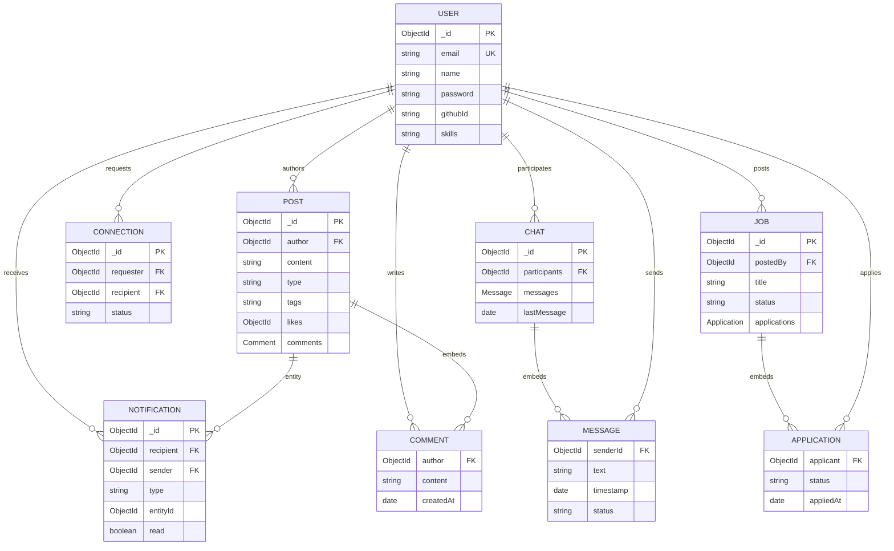

# 06 · Database and data models

## Database operations

MongoDB is connected by `config/database.js` via `MONGO_URI`; startup initiates the connection and exits on failure. Mongoose schemas define application validation, timestamps, references, indexes and password middleware. No migration framework, seed script, transaction usage, backup plan, or explicit pool configuration was found. MongoDB driver's defaults apply. Data integrity involving multiple documents is handled in controller logic; no cross-document transaction was identified.

ER edges are logical references/embedded records, not relational foreign key constraints. `Notification.entityId` is polymorphic and has no `refPath` configured. The enum `entityModel` labels possible targets.

## Collections and constraints

| Model | Shape/important rules | Indexes and usage |
|---|---|---|
| User | Required name/email; unique lowercase email; optional password (required unless githubId); password excluded by default; bio max 500; GitHub stats/repos, skills, pinned projects. bcrypt pre-save only when password modified. | Email unique; sparse githubId. Auth, profiles, discovery, relationships. |
| Post | Required author/content, max content 5000; update/project/collab enum; embedded comments max 1000 chars, likes array, image/snippet/tags. | createdAt descending, author+createdAt, type. Feed queries/populates. |
| Connection | requester, recipient, status pending/accepted/rejected, timestamps. | Unique `(requester,recipient)`; directional requests. |
| Chat | participants array, embedded messages with sender/text/status sent/delivered/read; lastMessage. Pre-save duplicate heuristic. | participants and lastMessage. Unbounded messages risk document growth. |
| Job | title/company/description, skills/requirements, type/location/budget, postedBy, embedded applications with files/status. | createdAt, skills, type, locationType. Embedded applications can grow without bound. |
| Notification | recipient/sender/type enum/entity metadata/message/read/timestamps. | recipient+createdAt, recipient+read. |

Mongoose validation is not a substitute for API validation, authorization, or safe query construction. Unique indexes can race and can fail on existing duplicate data; catch duplicate key errors. Lists use cursor patterns in post/user/job controllers. Inspect query plans and actual production volume before changing indexes. Embedded chats/jobs need a retention/normalization plan if they grow.

## Database alternatives

PostgreSQL would enforce relational connection/application relationships and support transactional updates/joins; it would require reshaping embedded messages/comments and adopting SQL migrations. MongoDB preserves current nested document access but requires manual referential integrity. Prisma/Drizzle pair with SQL and type-oriented query APIs; Mongoose matches current Mongo-specific schema/populate APIs. Raw Mongo driver gives control with less schema middleware. Any migration requires mapping ObjectIds, nested arrays, uniqueness and query pagination; no current automated migration path exists.
