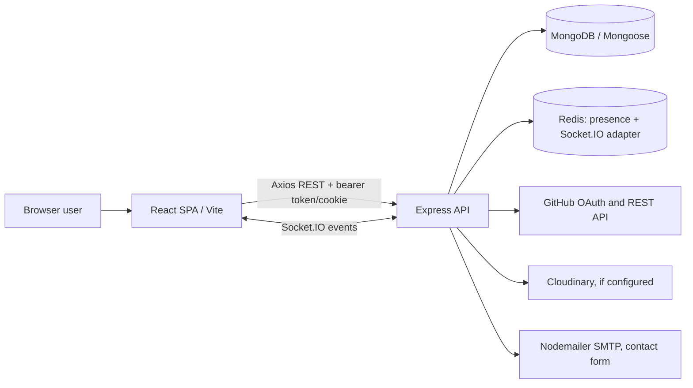

# DevConnect project notes

This guide describes the implementation found in this repository as inspected on 2026-11-05. Source and manifests are authoritative; older READMEs contain discrepancies called out in the relevant sections. It is a JavaScript application with separate Vite frontend and Express backend directories, sharing a Git repository but no workspace-level package manager or task runner.

## What the app does

DevConnect is a developer networking product: user profiles and GitHub data, developer discovery and connection requests, community posts/comments/likes, job and collaboration listings/applications, notifications, and direct messages with live presence and typing indicators.

## Stack at a glance

| Area | Verified implementation |
|---|---|
| Frontend | JavaScript, React 19, Vite 6, React Router 7, Redux Toolkit 2, Axios, Tailwind CSS 4, Radix primitives |
| Backend | Node.js/CommonJS, Express 5, REST controllers, Socket.IO 4 |
| Persistence | MongoDB through Mongoose 8; Redis/ioredis for socket adapter and presence |
| Identity | App-managed bcrypt password hashing and JWTs; GitHub OAuth flow implemented in `authController.js` |
| Media/email | Multer with Cloudinary or local disk; Nodemailer contact form |
| Hosting configuration | Vercel configuration files exist for API and SPA; backend README mentions Render but configuration alone does not verify production topology |

## Architecture

## Diagrams

- [System](diagrams/system-architecture.mmd), [repository](diagrams/repository-architecture.mmd), [frontend](diagrams/frontend-architecture.mmd), [backend](diagrams/backend-architecture.mmd)
- [Database ER](diagrams/database-er.mmd), [auth](diagrams/authentication-flow.mmd), [REST request lifecycle](diagrams/api-request-lifecycle.mmd), [realtime messaging](diagrams/realtime-workflow.mmd), [deployment configuration](diagrams/deployment-workflow.mmd)
- Feature flows: [posting](diagrams/feature-workflows/posts.mmd), [job application](diagrams/feature-workflows/jobs.mmd), [connections](diagrams/feature-workflows/connections.mmd)

## Reading order

1. [Overview](01-project-overview.md) and [architecture](03-architecture-and-design-decisions.md)
2. [Technology choices](02-tech-stack-deep-dive.md), [file reference](04-folder-and-file-reference.md), [feature walkthroughs](05-feature-and-code-walkthroughs.md)
3. [Data model](06-database-and-data-models.md), [auth/security](07-authentication-and-security.md), [API/realtime](08-api-and-realtime-workflows.md)
4. [Quality/testing](09-testing-and-code-quality.md), [developer setup](10-development-and-deployment-guide.md)
5. [Interview prep](11-interview-questions-and-answers.md), [rebuild guide](12-build-from-scratch-guide.md), [scaling](13-scalability-and-performance.md), [findings](14-improvements-and-technical-debt.md), [improvement playbook and interview answers](16-improvement-playbook.md), [glossary](15-glossary-and-quick-revision.md)

## Quick interview preparation

Start with the 45-second project answer in [the interview guide](11-interview-questions-and-answers.md#project-pitch), then draw the system diagram and explain the cookie/localStorage/bearer-token path and Socket.IO message persistence. Be candid that the codebase has no test suite and no CI workflow visible.

## Evidence boundaries

No Git history, frontend environment template, migrations, seed scripts, test files, root package manifest, CI workflow, or lockfile for the frontend was present in the inspected tree. Historical technology selection rationale is not recorded. Any choice rationale below is labeled retrospective. `better-auth`, `jsonwebtoken` use in frontend, and several backend dependencies need usage distinctions; inclusion in a manifest alone is not evidence of active use. Generated assets, stored uploads, and dependency/build directories are excluded from detailed source inventory.
